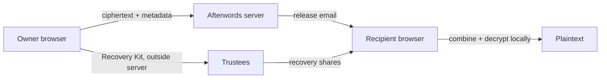

<div align="center">

# Afterwords

**A self-hosted dead man's switch with browser-only vault encryption and trustee-assisted recovery.**

Check in periodically. If you stay silent past your deadline and grace period, Afterwords releases encrypted messages to the people you chose. Encryption, key splitting, reconstruction, and decryption happen in the browser. A correctly built and operated server stores ciphertext and operational metadata, but never receives vault plaintext, the vault passphrase, the Data Key, or trustee recovery shares.

[](https://github.com/Dtdkvn/afterwords/actions/workflows/ci.yml) [](LICENSE)

[Quick start](#quick-start) · [How it works](#how-it-works) · [Security model](SECURITY.md) · [Demo](#run-the-accelerated-demo) · [Production checklist](#production-checklist)

</div>

> [!IMPORTANT]
> Afterwords is safety-adjacent software, not a substitute for a will, legal advice, emergency services, or a tested estate plan. Run fire drills, keep independent backups, and make sure trustees understand their role.

## Why Afterwords exists

- **The server is not trusted with the vault.** AES-GCM encryption, passphrase wrapping, Shamir splitting, reconstruction, and decryption happen locally in the browser.
- **Recipients get a humane flow.** A release link opens calm, numbered instructions instead of handing a grieving person a command-line puzzle.
- **The whole lifecycle is testable.** Recovery Kits, fire drills, durable email delivery, an audit trail, and accelerated time make failure visible before it matters.

Afterwords makes a narrow security promise, not a blanket claim. It protects vault content from database and backup disclosure and from an honest-but-curious server, but a compromised server can still serve malicious JavaScript. Read the [security model](SECURITY.md#the-web-delivered-cryptography-limitation) before relying on it.

## Quick start

```bash
git clone https://github.com/Dtdkvn/afterwords.git
cd afterwords
docker compose up --build
```

Open [http://localhost:8080](http://localhost:8080), create the single owner account, and follow the setup wizard. The SQLite database lives in the `afterwords-data` Docker volume.

> **Reach Afterwords over `localhost` or HTTPS.** All encryption happens in your browser through the Web Crypto API, which browsers expose only in a secure context. `http://localhost:8080` and `http://127.0.0.1:8080` qualify, so the default quick start works as written. Browsing to a plain-HTTP LAN address such as `http://192.168.1.10:8080` does not, and Afterwords will say so instead of pretending to encrypt. To reach it from another machine, terminate TLS at a reverse proxy and set `BASE_URL=https://…` with `SECURE_COOKIES=true`.

The default stack starts without a real SMTP server. Configure the `SMTP_*` variables before relying on reminders or releases; use the bundled Mailpit demo for a fully local test.

On a development network that inspects TLS, pass its trusted root to BuildKit as a secret instead of copying it into the image or repository:

```bash
docker build --secret id=afterwords_ca,src=/path/to/corporate-root.pem -t afterwords:local .
docker compose up --no-build
```

The secret is mounted only for dependency installation and is absent from the resulting layers. Ordinary networks should keep using `docker compose up --build` without this option.

## How it works



1. The owner creates a switch with a check-in interval and grace period.
2. The browser generates a random 256-bit Data Key and encrypts each vault item with AES-256-GCM.
3. A passphrase-derived Argon2id key wraps the Data Key for later owner access.
4. The browser splits the Data Key into a k-of-n trustee set. Only SHA-256 share fingerprints reach the server; the actual shares leave through printable/downloadable Recovery Kits.
5. A dashboard button, an explicitly confirmed one-use magic link, or a long-lived API token resets the deadline. Merely previewing the email link is side-effect-free so mail scanners cannot check in for the owner.
6. Missed deadlines move through `ACTIVE → OVERDUE → RELEASING → RELEASED`. Every transition is idempotent and audited, and every email is first committed to a durable outbox.
7. After release, trustees enter shares on the recipient page. Reconstruction and authenticated decryption happen in that browser.

For the exact trust assumptions and unavoidable limitations of web-delivered cryptography, read [SECURITY.md](SECURITY.md).

## Product tour

### Owner

- Four-step setup wizard with plain-language recovery guidance
- Large countdown and one-click **I'm alive** check-in
- Configurable pre-deadline and overdue reminders
- Pause/resume, API-token rotation, magic-link email, and per-switch audit history
- Client-encrypted Markdown and file vault, capped at 25 MB of ciphertext per switch
- Fire drill that emails only the owner with `[TEST]` content and never mutates real state

### Trustee

- Print-friendly Recovery Kit with a QR code and written share
- No account and no server-side share upload
- A clear explanation of when and how to help

### Recipient

- Mobile-first release page with a calm numbered flow
- Paste, type, or load enough shares from a local text file
- Local reconstruction, Markdown rendering without raw HTML, and decrypted file downloads

## Run the accelerated demo

The demo maps one real second to one virtual day and sends all mail to Mailpit:

```bash
TIME_SCALE=86400 make demo
```

Open the dashboard at [http://localhost:5173](http://localhost:5173) and Mailpit at [http://localhost:8025](http://localhost:8025). `TIME_SCALE` accelerates deadline and retry due-times; scheduler and sender polling loops still use real wall-clock intervals. Production must keep `TIME_SCALE=1`.

> [!WARNING]
> Never enable accelerated time in production. Startup emits a prominent warning whenever `TIME_SCALE` is not `1`.

The launch recording shot list is in [scripts/record-demo.md](scripts/record-demo.md).

## Check in from automation

The setup flow displays a per-switch API token once. Treat it like a password and call:

```bash
curl --fail --request POST \
  "https://afterwords.example/api/checkin/YOUR_SWITCH_TOKEN"
```

Rotate the token immediately if it appears in shell history, CI output, or logs. The response includes the new state and deadline, never vault data.

## Production configuration

Copy `.env.example` to `.env`, set a public HTTPS URL and SMTP credentials, then start the Compose stack.

| Variable | Default | Purpose |
| --- | --- | --- |
| `PORT` | `8080` | HTTP listen port |
| `BIND_ADDRESS` | `127.0.0.1` | Host address published by Compose; change only when a trusted reverse proxy or firewall protects first boot |
| `BASE_URL` | `http://localhost:8080` | Absolute origin used in email links |
| `DB_PATH` | `./afterwords.db` | SQLite database path; Compose uses `/data/afterwords.db` |
| `SETUP_TOKEN` | empty | Optional strong one-time secret required to create the first owner; unset and recreate the service after setup |
| `SMTP_HOST` / `SMTP_PORT` | empty / `1025` | SMTP relay; blank host disables successful delivery |
| `SMTP_USER` / `SMTP_PASS` | empty | Optional SMTP authentication |
| `SMTP_FROM` | `Afterwords <afterwords@localhost>` | Envelope/display sender |
| `SMTP_TLS_POLICY` | `mandatory` | `mandatory`, `opportunistic` (may fall back to plaintext), or `none`; weaker modes are only for controlled legacy/local relays, with `none` reserved for an unauthenticated sink such as Mailpit |
| `TIME_SCALE` | `1` | Virtual-time multiplier; production must stay at `1` |
| `SECURE_COOKIES` | `false` | Set `true` behind HTTPS |
| `TRUST_PROXY` | `false` | Enable only behind a proxy you control |
| `LOG_LEVEL` | `info` | Structured logging verbosity: `debug`, `info`, `warn`, or `error` |

### Production checklist

- Keep the first boot bound to loopback or a private network until the sole owner account is created; an uninitialized public instance can otherwise be claimed by its first visitor. For orchestrated/public first boot, also set `SETUP_TOKEN` to at least 32 random bytes, enter it once in the setup screen, then remove it from the environment and recreate the service.

- Terminate TLS at a trusted reverse proxy and set `BASE_URL=https://…` plus `SECURE_COOKIES=true`.
- Use a reliable transactional SMTP relay, keep `SMTP_TLS_POLICY=mandatory`, and verify SPF, DKIM, and DMARC. Afterwords rejects SMTP authentication when TLS is disabled.
- Persist and back up the `/data` volume. Test restore procedures on a separate instance.
- Store `.env` outside source control and restrict database/backups to the service account.
- Run a complete fire drill after setup and after every infrastructure change.
- Monitor `/healthz`, disk space, and `email.dead_lettered` error logs. After 10 failed attempts, the message is retained and a non-secret terminal event appears in the switch's **Activity** tab. Correct the SMTP problem there, then choose **Retry delivery**; the retry and eventual delivery are both audited.

Backups contain authentication data, contact metadata, schedules, audit history, and ciphertext. They do not contain plaintext, the vault passphrase, the Data Key, or trustee shares, but they are still sensitive.

## Single-binary install

Tagged releases are configured to produce CGO-free binaries for Linux amd64/arm64 and macOS arm64, plus SHA-256 checksums and an SBOM for each archive.

```bash
tar -xzf afterwords_VERSION_linux_amd64.tar.gz
./afterwords
```

Set `DB_PATH`, `BASE_URL`, SMTP variables, and `SECURE_COOKIES` in the service manager. The React application is embedded in the executable.

## Develop locally

Prerequisites: Go 1.25+, Node.js 24+, npm, GNU Make, Bash, standard POSIX utilities, `curl`, and Docker for the Mailpit/demo flow. On Windows, run the Make targets from WSL or an equivalent environment; plain PowerShell does not provide the shell utilities used by the Makefile and demo script.

```bash
make setup
make test
make build
```

Useful targets:

| Command | What it does |
| --- | --- |
| `make dev` | Runs the API, Vite, and Mailpit with Compose |
| `make lint` | Checks Go formatting/vet/golangci-lint and frontend lint rules |
| `make test` | Runs Go race/unit/integration tests and Vitest crypto tests |
| `make e2e` | Runs the Playwright release/recovery and state-control flows |
| `make demo` | Runs the accelerated end-to-end scenario |
| `make build` | Builds the frontend and embedded static binary |

## Architecture

```text
cmd/afterwords/       process wiring, workers, graceful shutdown
internal/clock/       real and scaled injected clocks
internal/engine/      idempotent reminder/release state machine
internal/store/       migrations and transactional SQLite operations
internal/server/      strict HTTP API, auth middleware, embedded SPA
internal/mail/        templates and durable SMTP sender
migrations/           embedded sequential SQL migrations
web/                  React/Vite UI and browser-only cryptography
e2e/                  Playwright release/recovery and state-control flows
scripts/              accelerated demo and recording guide
```

The scheduler is intentionally single-process in v0.1. SQLite plus stable event keys make every scan retry-safe; high availability and multiple owners are explicit non-goals for this release.

## How Afterwords differs

| Capability | Timer script | Typical server-readable vault | Afterwords |
| --- | :---: | :---: | :---: |
| Periodic check-in and grace period | ✓ | ✓ | ✓ |
| Client-side authenticated encryption | — | varies | ✓ |
| Built-in k-of-n trustee recovery | — | — | ✓ |
| Server never receives recovery shares | — | — | ✓ |
| Non-technical recipient experience | — | varies | ✓ |
| Durable outbox and audit trail | — | varies | ✓ |
| Safe fire drill and accelerated demo time | — | — | ✓ |

This compares product shapes, not security certifications. Verify alternatives directly before making operational decisions.

## Scope

v0.1 deliberately supports one owner, one SQLite process, email delivery, local storage, and browser-based recovery. Telegram, generic webhooks, WebAuthn, multiple accounts, S3, mobile apps, and a signed offline recipient bundle belong to later releases.

## Contributing

Read [CONTRIBUTING.md](CONTRIBUTING.md) before opening a change. Maintainers can use the [launch kit](docs/LAUNCH.md) for repository metadata, announcement copy, and the publication checklist. Security issues belong in a [private GitHub Security Advisory](https://github.com/Dtdkvn/afterwords/security/advisories/new), not a public issue.

## License

[MIT](LICENSE)
